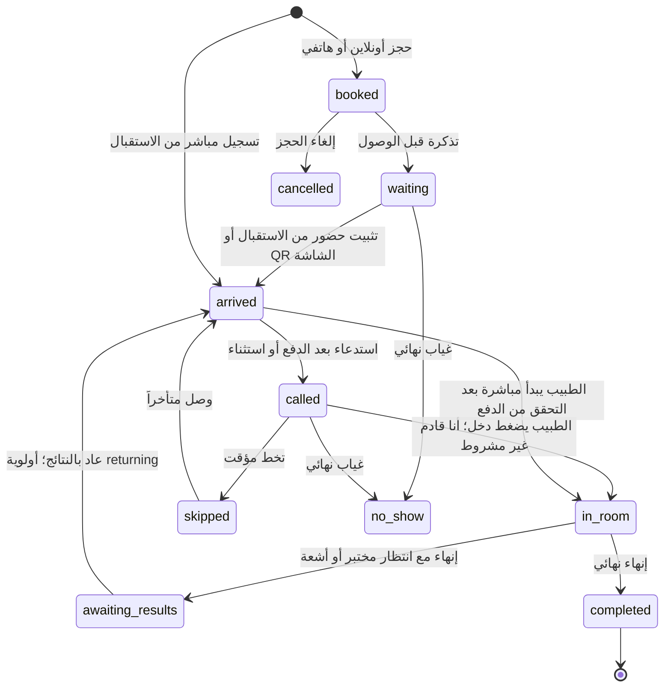

# دورة حياة المراجع

هذا التقرير من كود `fix/patient-lifecycle`، وليس تصوراً مستقبلياً. الحالات أسماء محفوظة بالخادم، أما «بانتظار الدفع» فهي وصف عرض لحاضر لم يسدد الكشفية.

## المخطط العام

`booked` حالة الحجز، و`waiting` حالة تذكرته قبل الوصول، وليستا نفس الجدول. الإنهاء النهائي يغلق التذكرة والحجز المرتبط. لا توجد حالة منفصلة اسمها «خرج من المجمع»؛ `completed` تعني انتهاء زيارة الطبيب، وقد تبقى فحوص أو فواتير منفصلة.

## الرحلات والخطوات

| الحالة/الخطوة | من وأين | قبل ← بعد | الإشعار والدفع |
|---|---|---|---|
| تسجيل ملف | المراجع من تطبيق المريض أو الاستقبال من حضور وتسجيل | لا ملف ← ملف ورقم ملف | لا يشترط الدفع للتسجيل؛ الهاتف اختياري للاستقبال |
| حجز أونلاين | المراجع: الفرع ثم الطبيب ثم اليوم | لا حجز ← booked وتذكرة waiting | تأكيد الحجز وإشعار بحفظه؛ ليس حضوراً فعلياً |
| دفع الحجز | المراجع من شاشة الدفع | unpaid ← paid أو deposit_paid | إشعار نتيجة الدفع؛ لا يعتمد نجاح الصفحة بل استعلام الخادم عن البوابة |
| وصول حاجز دفع كاملاً | الاستقبال: تثبيت الحضور، أو المراجع يمسح QR الشاشة | waiting ← arrived والحجز checked_in | تحديث booking.changed وqueue.updated وmy_queue.updated؛ تُربط الكشفية المسددة فلا يدفعها مرتين |
| وصول حاجز لم يدفع | نفس شاشة الحضور | waiting ← arrived مع awaiting_payment | تحديث الطابور؛ التحصيل مطلوب قبل الدخول، والعربون رصيد يُطرح وفق منطق التحصيل |
| حضور مباشر | الاستقبال: إنشاء/اختيار الملف ثم اختيار الطبيب وتسجيل الحضور | لا تذكرة ← arrived وفاتورة | يحصل على رقم وتذكرة دون حجز أو تطبيق؛ لا يدخل قبل الدفع |
| حضور بلا هاتف | الاستقبال: الاسم والعمر/الميلاد والهاتف فارغ | لا ملف ← ملف برقم ثم arrived | يُبحث عنه بالاسم/رقم الملف؛ لا يُنشأ هاتف وهمي ولا OTP ولا «لم يرد» |
| تحصيل | الاستقبال: التحصيل وطباعة/معاينة الوصل | كشفية unpaid ← paid | إيصال وتحديث الطابور؛ يلزم حساب يومي مفتوح وصلاحية payments.collect |
| طوارئ | الاستقبال/الطبيب: طوارئ مع سبب | normal ← emergency | تدقيق وتحديث ترتيب الطابور؛ يسمح بالدخول قبل الدفع، ولا يمحو الدين |
| استدعاء | الاستقبال أو الطبيب حسب سياسة الفرع | arrived ← called | رقم على الشاشة وتنبيه بالمريض للحساب المرتبط؛ ليس بدء المعاينة |
| تم، أنا قادم | المراجع في تنبيه حان دورك | called تبقى called؛ يحفظ call_acknowledged_at | يوقف تكرار التنبيه ويخبر الاستقبال والطبيب بأنه رد؛ لا يثبت دخول الغرفة ولا يسدد |
| حضر نيابة عنه | الاستقبال: زر حضر بعد الاستدعاء | called تبقى called؛ يحفظ وقت التأكيد | نفس شارة التأكيد وتحديث الطابور؛ لا هاتف ولا تطبيق مطلوب |
| بدء المعاينة | الطبيب: دخل/بدء المعاينة | called أو arrived ← in_room | تحديث الطابور؛ التحقق من الدفع، عدا الطوارئ/الآجل المعتمد/العائد. لا فحص لـ«أنا قادم» |
| انتظار النتائج | الطبيب: حفظ وإنهاء مع عودة، أو منطق التحويلات غير المكتملة | in_room ← awaiting_results | يظهر بانتظار القسم؛ يخرج من ترتيب الدخول حتى العودة |
| عودة المختبر/الأشعة | الاستقبال: عاد بالنتائج أو نتائج خارجية | awaiting_results ← arrived بأولوية returning | نفس التذكرة والكشفية دون فاتورة كشف جديدة؛ الجاهزية تُقرأ من التحويلات، والأقسام/النتائج الخارجية لها شروطها |
| إنهاء نهائي | الطبيب: إنهاء فقط أو إنهاء واستدعاء التالي | in_room ← completed | إغلاق الحجز إن وجد وتحديث الطابور؛ الاستقبال يستطيع الإنهاء لطبيب لا يستخدم النظام وفق سياسة الفرع |
| غياب أو إلغاء | الاستقبال/المراجع أو المهمة الدورية بحسب الحالة | انتظار/حجز ← no_show أو cancelled | إشعار وإعادة الترتيب؛ الاسترجاع/الرصيد والغرامة بحسب السياسة. المدفوع إلكترونياً مع غياب نهائي يُعامل وفق قواعد الرصيد، لا قبض جديد |

## إجابات مباشرة

- **كيف يدخل بلا هاتف؟** ينشئ الاستقبال ملفه بالاسم والعمر أو الميلاد مع الهاتف فارغاً، ثم يسجله حضوراً مباشراً ويحصّل الكشفية ويستدعيه. يضغط الاستقبال «حضر»، والطبيب «دخل». لا يحتاج هاتفاً أو حساب مراجع؛ البحث برقم الملف.
- **كيف يدخل المباشر؟** حضور وتسجيل ← اختيار/إنشاء الملف والطبيب ← تسجيل الحضور وإنشاء التذكرة والفاتورة ← تحصيل ← استدعاء ← الطبيب يبدأ. الطوارئ والاستثناء المالي لهما قواعدهما الموثقة أعلاه.
- **هل أنا قادم شرط؟** لا، لا في الخادم ولا في زر دخل. هو رد على التنبيه فقط. يمكن بدء المعاينة مع عدم الرد بعد الاستدعاء والدفع.
- المراجع المباشر بلا تطبيق لا يظهر «لم يرد». صاحب حساب التطبيق المربوط يستطيع الرد حتى لو سجله الاستقبال مباشرة. بعد «حضر» تظهر شارة التأكيد مع الوقت.

## أزرار الطابور

| الشاشة | الزر | ما يفعله |
|---|---|---|
| الاستقبال | تثبيت الحضور | يثبت الحجز ويفتح كشفية/يربط المسدد؛ لا يبدأ المعاينة |
| الاستقبال | تحصيل | يفتح السلة والتحصيل ومعاينة الوصل |
| الاستقبال والطبيب | استدعاء/استدعاء التالي | يختار جاهزاً حاضراً ومدفوعاً وفق الترتيب وسياسة الاستدعاء |
| الاستقبال | حضر | يؤكد وصول المستدعى نيابة عنه، بلا شرط تطبيق |
| الاستقبال | إعادة استدعاء | يبدأ تنبيه استدعاء جديد ويصفّر رد الاستدعاء السابق |
| الاستقبال | تخط مؤقت | skipped؛ لا إنهاء ولا غياب نهائي |
| الاستقبال | وصل متأخراً | يعيد الغائب مؤقتاً/المتأخر إلى الحضور وفق السياسة |
| الاستقبال | عاد بالنتائج | يفعّل العودة بنفس التذكرة بأولوية returning |
| الاستقبال والطبيب | طوارئ | يحتاج سبباً، يقدم التذكرة ولا يجعل الفاتورة مدفوعة |
| الاستقبال | طباعة التذكرة | يطبع الرقم؛ لا يغيّر حالة الزيارة |
| الاستقبال | غياب نهائي | يغلق كتغيب، ويطبق قواعد الغياب والرصيد/الحظر |
| الطبيب | دخل | يبدأ المعاينة الفعلية دون اشتراط أنا قادم |
| الطبيب | فتح المعاينة/السجل | يفتح المحتوى الطبي دون تغيير حالة الطابور |
| الطبيب | حفظ | يحفظ المحتوى فقط؛ ليس إنهاء تلقائياً |
| الطبيب | حفظ وإنهاء/إنهاء فقط | ينهي نهائياً أو ينتظر النتائج حسب الاختيار والتحويلات |
| الطبيب أو استقبال مخوّل | إنهاء واستدعاء التالي | ينهي الحالي ثم يستدعي الجاهز التالي إن وجد |

## سبب خلل الغرفة والإصلاح

`DoctorQueue/useMyQueue` كان يعرض وجبة واحدة، و`QueueService.StartCoreAsync` يمنع بدء مريض جديد عند وجود `in_room` في **أي** وجبة للطبيب. لذلك تخفي وجبة اليوم معاينة أمس أو وجبة سابقة غير منتهية. الإصلاح يجعل قراءة الطبيب تعرض الوجبة ذات المعاينة المعلقة أولاً، مع تاريخها وزري فتح المعاينة وإنهاء فقط. لا يُغلق الخادم أي معاينة تلقائياً ولا يغيّر ترتيب الطابور. بعد الإنهاء يعود العرض إلى وجبة اليوم. فشل عملية الطبيب يعيد تحديث القراءة كي لا يبقى عرض قديم.

## التابات

الجلسة `rahma.staff.session` في localStorage مشتركة بين تابات نفس المتصفح. حدث storage كان يبدّل مستخدم التاب القديم وينقله لقسم الحساب الجديد. بقيت سياسة الجلسة الواحدة كما هي؛ عند تبدّل user_id تتوقف واجهة التاب القديم برسالة «تم تسجيل الدخول بحساب آخر في هذا المتصفح». تجديد التوكن لنفس المستخدم لا يطلق الرسالة. كل حساب اختبار في متصفح أو جلسة خاصة مستقلة؛ نافذتان خاصتان في نفس المتصفح قد تشتركان أيضاً في الجلسة.

## مراجع الكود

- backend/src/AlRahma.Application/Queue/QueueService.cs: CheckIn/Call/Start/Complete/Returned/ConfirmPresence.
- backend/src/AlRahma.Application/Queue/QueueReader.cs وQueueEngine.cs: العرض، الرد، الترتيب والإشعارات.
- backend/src/AlRahma.Application/PatientApp/MyQueueService.cs: رد أنا قادم.
- backend/src/AlRahma.Application/Clinical/ConsultationService.cs: حفظ المحتوى مقابل إنهاء الزيارة.
- backend/src/AlRahma.Application/Notifications/ScheduledJobs.cs: التذكير والغياب وتكرار الاستدعاء.
- frontend/components/doctor/doctor.tsx، reception/queue-screen.tsx، reception/checkin-screen.tsx، patient/app.tsx.
- frontend/lib/api/session-store.ts وfrontend/lib/auth/store.ts: مزامنة الجلسة.

## التحقق المنفذ

نجحت 17 حالة في اختبارات PatientLifecycleTests وMockGatewayTests وPatientTests وPatientAlertsTests. تشمل حجزاً أونلاين ببطاقة Luhn عامة ثم الدفع والتحقق والحضور والاستدعاء وأنا قادم والبدء والإنهاء، ونفس الرحلة دون أنا قادم، ومحفظة زين كاش عامة، ومباشراً بلا هاتف مع تحصيل فعلي ثم حضر والبدء والإنهاء، ومعاينة قديمة تمنع بدء أخرى ثم تظهر وتُغلق. التنفيذ على HTTP عبر TestServer والخدمات وقاعدة PostgreSQL الحقيقية، بمخطط اختبار عشوائي داخل alrahma_staging فقط؛ يُحذف المخطط عند الانتهاء ولا تُمس بيانات public. تقرير التشغيل المحلي: test-results/lifecycle.trx خارج المستودعات. لم توجد عند فحص بيانات public معاينة in_room معلقة؛ سبب الاختلاف أعيد إنتاجه في اختبار وجبتين.
