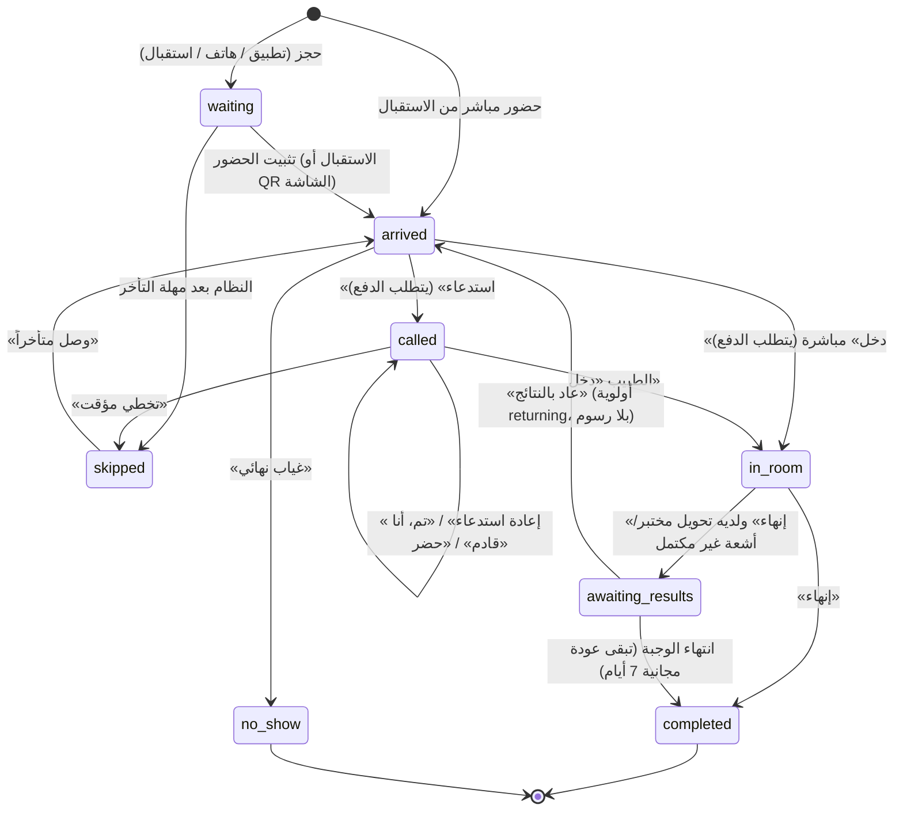
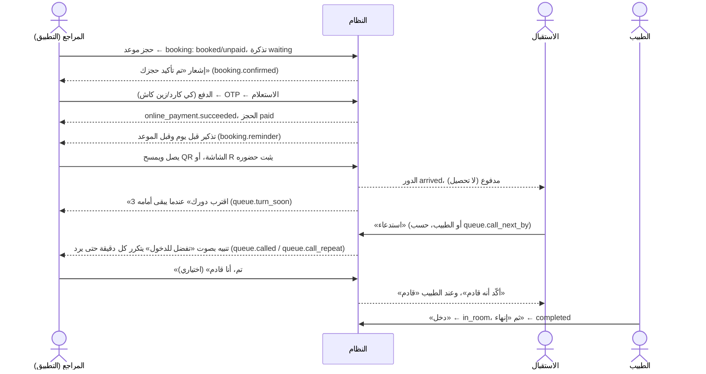
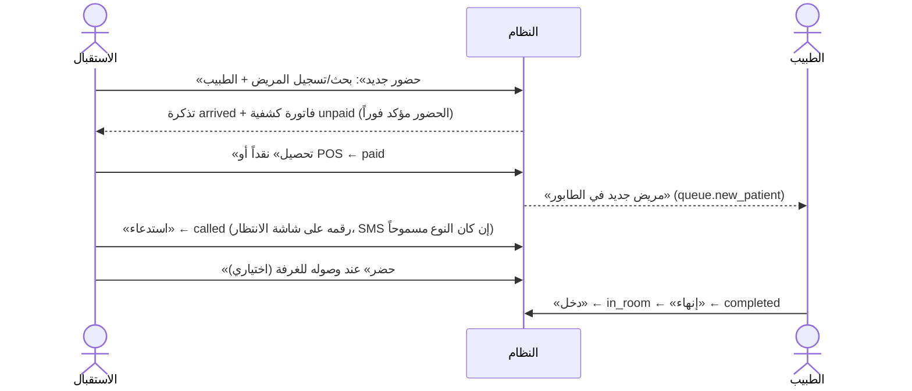

# دورة حياة المراجع: من التسجيل حتى الخروج

> مكتوب من الكود الفعلي في 2026-11-07 (الفرع `fix/patient-lifecycle`): `QueueService.cs` و`QueueReader.cs` و`BookingService.cs` و`OnlinePaymentService.cs` و`NotificationService.cs` في الخادم، وشاشات `reception/queue-screen.tsx` و`doctor/doctor.tsx` و`patient/app.tsx` في الواجهة.

## الأجوبة المختصرة

| السؤال | الجواب |
|---|---|
| **هل ضغطة «تم، أنا قادم» شرط للدخول؟** | **لا، أبداً.** الخادم يسمح ببدء المعاينة لأي دور «مستدعى» أو «واصل» إذا كانت الكشفية مدفوعة (أو طوارئ أو عائد بالنتائج). لا يوجد أي فحص لـ «أنا قادم» في `start` ولا في `call` ولا في واجهة الطبيب. تأكد ذلك باختبار `Called_patient_enters_without_acknowledgement_and_reception_can_mark_present` وبرحلة فعلية على `alrahma_staging`. |
| **كيف يدخل المراجع بلا هاتف؟** | ملف المريض يتطلب رقم هاتف (يُقبل رقم أحد أقاربه). إذا لم يكن لهذا الرقم حساب في التطبيق فهو «بلا تطبيق»: يسجله الاستقبال ويثبت حضوره ويحصّل منه، ثم يُستدعى فيظهر رقمه على شاشة الانتظار (وتصل SMS للرقم إن وُجد)، ويضغط الاستقبال **«حضر»** عند وصوله لباب الغرفة (اختياري)، ثم يضغط الطبيب **«دخل»**. لا تظهر له «لم يرد» أبداً. |
| **كيف يُسجَّل المراجع المباشر ويؤكَّد حضوره ويدخل؟** | الاستقبال: «حضور جديد» (بحث أو تسجيل مريض جديد) ← اختيار الطبيب ← يُنشأ له دور **«واصل»** مباشرة مع فاتورة الكشفية (الحضور مؤكد بمجرد التسجيل لأنه واقف أمام الاستقبال) ← «تحصيل» ← «استدعاء» (من الاستقبال أو الطبيب حسب إعداد الفرع) ← «حضر» (اختياري) ← الطبيب «دخل» ثم «إنهاء». |

## الحالات

**حالات الدور (التذكرة) `queue_tickets.status`:**

| الحالة | المعنى بالعربي | تظهر في الشاشات |
|---|---|---|
| `waiting` | محجوز لم يصل بعد | «محجوز» |
| `arrived` | واصل (حضر للمجمع) | «وصل»، ومعها «حاضر — بانتظار الدفع» إن لم يدفع |
| `called` | مستدعى للغرفة | «تم الاستدعاء» |
| `in_room` | داخل الغرفة (المعاينة جارية) | «في الغرفة الآن» |
| `completed` | انتهت الزيارة | «مكتمل» |
| `awaiting_results` | ذهب للمختبر أو الأشعة وسيعود | «بانتظار المختبر…» / «جاهز للعودة» |
| `skipped` | تخطٍّ مؤقت (لم يحضر في وقته) | «متخطى» |
| `no_show` | غياب نهائي | «غائب» |
| `cancelled` | ملغى | لا يظهر |

**حالات الحجز `bookings.status`:** `booked` (محجوز) ← `checked_in` (ثبّت حضوره) ← `completed`، أو `cancelled` / `no_show`. **حالة دفع الحجز:** `unpaid` / `deposit_paid` (عربون) / `paid`.

**الأولوية `priority`:** `emergency` (طوارئ، أولاً) ← `returning` (عائد بالنتائج) ← `normal` و`late_reinserted` (وصل متأخراً).

**شرط الدفع:** في **«استدعاء»** و**«دخل»** فقط: الكشفية مدفوعة أو مؤجلة معتمدة (`402 INVOICE_UNPAID` غير ذلك)، عدا الطوارئ والعائد بالنتائج. تثبيت الحضور لا يتطلب الدفع.

## المخطط العام

## 1) حاجز أونلاين دفع مسبقاً (كي كارد أو زين كاش)

| الخطوة | من | الشاشة | قبل ← بعد | الإشعار | الدفع |
|---|---|---|---|---|---|
| الحجز | المراجع | التطبيق: الحجز | — ← `waiting` / حجز `booked` | `booking.confirmed` | لا |
| الدفع | المراجع | التطبيق: صفحة البوابة | حجز `unpaid` ← `paid` | `online_payment.succeeded` | **هنا** |
| التذكير | النظام | — | — | `booking.reminder` (يوم قبل، وقبل الموعد) | — |
| تثبيت الحضور | المراجع (QR) أو الاستقبال | التطبيق: مسح QR / الاستقبال: «مرضى اليوم» أو «حضور وتسجيل» | `waiting` ← `arrived` | `booking.changed` للشاشات | لا شيء مستحق |
| اقتراب الدور | النظام | — | — | `queue.turn_soon` | — |
| الاستدعاء | الاستقبال أو الطبيب | الطابور الحي / طابوري | `arrived` ← `called` | `queue.called` ثم `queue.call_repeat` (حتى 3 مرات) + الرقم على شاشة الانتظار | يُفحص (مدفوع) |
| «تم، أنا قادم» | المراجع | التطبيق: نافذة «حان دورك» | يبقى `called` (يُسجل وقت التأكيد) | توقف التكرار | — |
| البدء | الطبيب | طابوري: «دخل» | `called` ← `in_room` | — | يُفحص |
| الإنهاء | الطبيب | طابوري أو المعاينة | `in_room` ← `completed` (الحجز `completed`) | — | — |

## 2) حاجز لم يدفع (هاتفي أو تطبيق بلا دفع)

مثل السابق، لكن عند تثبيت الحضور تُنشأ فاتورة الكشفية **غير مدفوعة** فيظهر «حاضر — بانتظار الدفع». يضغط الاستقبال «تحصيل» (`POST /payments`)، فيصل الطبيب إشعار «مريض جديد في الطابور» (`queue.new_patient`). «استدعاء» قبل الدفع يرد `402 INVOICE_UNPAID`. إذا كان دفع عربوناً يُطرح من المطلوب. إذا لم يصل حتى موعده + المهلة (20 دقيقة) يصبح «متخطى» تلقائياً، وإن وصل بعدها يضغط الاستقبال «وصل متأخراً».

## 3) مراجع مباشر بلا حجز

* لا يمر بحالة `waiting`: تسجيله في الاستقبال هو تأكيد حضوره.
* إذا كانت الوجبة ممتلئة: `409 SESSION_FULL_EXTRA_POSSIBLE` فيؤكد الاستقبال قبوله «إضافي».
* إذا أُغلق التسجيل: `409 REGISTRATION_CLOSED` (يمكن فتحه من الطابور).

## 4) طوارئ

الاستقبال أو الطبيب يضغط «طوارئ» مع السبب على أي دور واصل أو محجوز أو متخطى: يصبح `arrived` بأولوية `emergency` في **أول** الطابور (تُنشأ فاتورته إن لم تكن). **لا يُشترط الدفع** للاستدعاء والدخول (تُحصّل لاحقاً). بعدها نفس المسار: استدعاء ← دخل ← إنهاء. يسجل في التدقيق `TICKET_EMERGENCY`.

## 5) عائد من المختبر أو الأشعة

1. الطبيب يطلب تحليلاً أو أشعة أثناء المعاينة، ثم «إنهاء» ← لأن التحويل لم يكتمل تصبح التذكرة `awaiting_results` («بانتظار المختبر»)، والحجز لا يكتمل.
2. يدفع المراجع للمختبر في الاستقبال، ويُنجز التحليل؛ الشارة تصبح «جاهز للعودة».
3. عند عودته يضغط الاستقبال **«عاد بالنتائج»** (أو «عاد بنتيجة خارجية»): يعود `arrived` بأولوية `returning` على **نفس الكشفية** بلا فاتورة ولا رقم جديد، ولا يُشترط دفع للاستدعاء.
4. استدعاء ← دخل ← «إنهاء» ← `completed`.
5. إذا انتهت الوجبة وهو ينتظر: يصبح `completed` وتبقى له **عودة مجانية 7 أيام**. عند تسجيله لاحقاً عند نفس الطبيب يسأل النظام: «عودة بالنتائج» (مجاني) أم «زيارة جديدة» (`409 RETURN_OR_NEW_REQUIRED`).

## 6) مراجع بلا هاتف أو بلا تطبيق

* **ملف المريض يتطلب رقم هاتف** (`POST /patients`)؛ لمن لا يملك هاتفاً يُسجل رقم قريب له.
* «بلا تطبيق» = لا يوجد حساب في التطبيق مربوط بالملف (`has_app: false` في الطابور).
* مساره هو مسار المراجع المباشر (3) أو الحاجز الهاتفي (2). الاستدعاء يظهر رقمه على شاشة الانتظار، وتصل SMS لرقمه لأنواع الاستدعاء واقتراب الدور (في الوضع التجريبي تُسجل ولا تُرسل).
* **لا تظهر عنده «لم يرد»** ولا «بانتظار رده»: لا يستطيع الضغط على «تم».
* عند وصوله لباب الغرفة يضغط الاستقبال **«حضر»** إن أراد إعلام الطبيب (يظهر عند الطبيب «حضر»). وهو اختياري: الطبيب يضغط «دخل» بدونه.

## دور «تم، أنا قادم»

* **متى يظهر:** في تطبيق المراجع فقط، مع تنبيه «حان دورك / تفضل للدخول» بعد كل **استدعاء** أو **إعادة استدعاء**، إذا كان للمريض حساب في التطبيق.
* **ماذا يفعل:** يسجل وقت التأكيد (`call_acknowledged_at`، ومن أكّد `call_ack_by = patient`) ويوقف تكرار التنبيه. لا يغير حالة الدور.
* **عند الاستقبال:** قبل الرد «نُبّه في التطبيق · بانتظار رده»، وبعد المهلة (`queue.call_ack_timeout_minutes`، افتراضياً 3 دقائق) «لم يرد» — **لمن له تطبيق فقط**. بعد الضغط «أكّد أنه قادم · الوقت». بعد «حضر» من الاستقبال: «حضر · الوقت».
* **عند الطبيب:** كلمة «قادم» (أو «حضر») بجانب اسمه في «التالي في طابوري». معلومة فقط.
* **ليس شرطاً للدخول.** «لم يرد» تعني: قد لا يكون قريباً، فقرر بنفسك: انتظر، «إعادة استدعاء»، «تخطي مؤقت»، أو أدخله إن حضر.

## أزرار الطابور

### الاستقبال (الطابور الحي ← لوحة الدور المحدد)

| الزر | متى يعمل | ماذا يفعل | الطلب |
|---|---|---|---|
| حضور جديد | دائماً | تسجيل مراجع مباشر أو تثبيت حضور حجز | `POST /queue/check-in` |
| تحصيل | الكشفية غير مدفوعة | يفتح شاشة التحصيل للمريض | `POST /payments` |
| استدعاء / إعادة استدعاء | واصل أو مستدعى، مدفوع (أو طوارئ/عائد)، وسياسة الفرع تسمح للاستقبال | `called`، تنبيه المراجع وشاشة الانتظار | `POST /queue/tickets/{id}/call` |
| استدعاء التالي | سياسة الفرع تسمح | يستدعي أول واصل مدفوع | `POST /queue/call-next` |
| **حضر** (جديد) | مستدعى ولم يؤكد أحد حضوره | يؤكد حضوره نيابة عنه؛ تختفي «لم يرد» ويتوقف التنبيه | `POST /queue/tickets/{id}/present` |
| إنهاء واستدعاء التالي | مستدعى أو في الغرفة (لطبيب لا يستخدم النظام) | ينهي الزيارة ويستدعي التالي | `POST /queue/tickets/{id}/complete` |
| طباعة التذكرة | ليس «محجوز» | تذكرة برقم الدور | الوكيل المحلي |
| تخطي مؤقت | محجوز، واصل، مستدعى | `skipped`، يخرج من الحساب | `POST /queue/tickets/{id}/no-show` `skip` |
| وصل متأخراً | متخطى أو محجوز | يعود `arrived` في أول فجوة بلا رسوم جديدة | `POST /queue/tickets/{id}/late-arrival` |
| غياب نهائي | غير منتهٍ وليس في الغرفة | `no_show`، قد يحظر المريض، يلغي الكشفية غير المدفوعة | `no-show` `final` |
| طوارئ | غير منتهٍ وليس في الغرفة | أول الطابور، بلا شرط دفع | `POST /queue/tickets/{id}/emergency` |
| عاد بالنتائج / بنتيجة خارجية | بانتظار قسم | يعود `arrived` بأولوية returning | `POST /queue/tickets/{id}/returned` |
| الطبيب وصل، تأخر الطبيب، تمديد اليوم، إغلاق/فتح التسجيل | لوحة الدوام | تحكم بالوجبة | `/queue/sessions/{id}/...` |

### الطبيب (طابوري)

| الزر | متى يعمل | ماذا يفعل |
|---|---|---|
| استدعاء التالي / أيقونة الاستدعاء | لا أحد في الغرفة، وسياسة الفرع تسمح للطبيب | `called` |
| **دخل** | مستدعى **أو** واصل، مدفوع (أو طوارئ/عائد)، ولا توجد معاينة مفتوحة | `in_room` ويفتح المعاينة. **لا يحتاج «أنا قادم»** |
| فتح المعاينة / السجل | مريض في الغرفة | شاشة الكشف والوصفة والطلبات |
| إنهاء فقط / إنهاء واستدعاء التالي | مريض في الغرفة | `completed` أو `awaiting_results` |
| **إنهاء المعاينة المعلّقة** (جديد) | معاينة بقيت «في الغرفة» من وجبة سابقة | يغلقها `completed` حتى يستطيع بدء معاينة جديدة |
| طوارئ | دور غير طارئ | أول الطابور |

## الإصلاحات المرتبطة (2026-11-07)

1. **«أنهِ المعاينة الحالية أولاً» مع «لا يوجد مريض في الغرفة»:** الخادم كان يمنع البدء إذا وُجدت **أي** تذكرة `in_room` للطبيب في **أي يوم**، والشاشة تعرض وجبة اليوم فقط. على `alrahma_staging` بقيت التذكرة A-007 (د. سعد، 2026-11-06) «في الغرفة» منذ أمس. الآن: الخطأ `DOCTOR_BUSY` يذكر رقم المعاينة المعلّقة واسم المريض والتاريخ، و`GET /queue/live` يعيد `open_exams_elsewhere`، وشاشة الطبيب تعرض بطاقة «معاينة سابقة لم تُغلق» مع زر «إنهاء المعاينة المعلّقة» وتخفي «دخل» حتى تُغلق.
2. **«تم، أنا قادم»** لم تكن شرطاً في أي مكان (تحققنا من `call` و`call-next` و`start` و`complete` وواجهة الطبيب). أُضيف زر **«حضر»** و`has_app`، و«لم يرد» لا تظهر لمن بلا تطبيق.
3. **تعدد التبويبات:** انظر `docs/handoff/accounts.md`.
